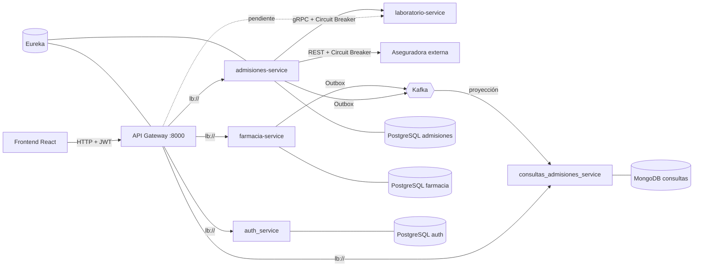

# Arquitectura — Red hospitalaria multi-sede

Este documento describe la arquitectura **tal como está construida** al corte del proyecto. Lo que aún no existe se indica de forma explícita.

## 1. Visión general

El sistema coordina admisiones, disponibilidad de camas, medicación y consulta consolidada del paciente entre varias sedes. Se construyó como un conjunto de microservicios Spring Boot (Java 25, Spring Boot 4.1) detrás de un API Gateway, con un frontend React que consume únicamente el gateway.

| Componente | Puerto | Almacenamiento | Responsabilidad |
|---|---|---|---|
| `eureka-server` | 8761 | — | Descubrimiento de servicios |
| `gateway` | 8000 | — | Punto único de entrada, enrutamiento por `lb://`, validación JWT y autorización por rol |
| `auth_service` | 8085 | PostgreSQL (5436) | Usuarios, roles y emisión de JWT |
| `admisiones-service` | 8080 | PostgreSQL (5432) | Admisiones, traslados, alta, inventario de camas, cobertura (HU-01, 02, 03, 07, 09, 10) |
| `farmacia-service` | 8081 | PostgreSQL (5433) | Solicitudes y despacho de medicamentos (HU-06) |
| `consultas_admisiones_service` | 8083 | MongoDB (27017) | Modelo de lectura CQRS: estado consolidado del paciente (HU-08) |
| `laboratorio-service` | 9091 (gRPC esperado) | — | **No entregado al corte** (HU-04, HU-05) |
| Kafka | 9092 | — | Bus de eventos entre servicios |

## 2. Diagrama

## 3. Estilo interno de cada servicio

`admisiones-service`, `auth_service` y `farmacia-service` siguen una arquitectura hexagonal con tres capas: `dominio` (entidades y reglas), `aplicacion` (casos de uso y puertos) e `infraestructura` (controladores REST, JPA, Kafka, gRPC, clientes HTTP). El núcleo depende de interfaces (puertos como `RepositorioAdmisiones`, `ConsultaCoberturaExterna`, `VerificadorLaboratorioPuerto`, `GeneradorIdPaciente`) y nunca de la tecnología concreta, lo que cumple el requisito de que la lógica clínica no dependa de cada integración externa.

## 4. Decisiones de arquitectura

## ADR-001: Arquitectura hexagonal y DDD en cada servicio

**Contexto.** Los requisitos piden que la lógica clínica no dependa de la tecnología de cada integración (laboratorio, aseguradora).

**Decisión.** Cada servicio separa dominio, aplicación e infraestructura. Las integraciones se acceden por puertos; los adaptadores se activan por perfil (por ejemplo, la aseguradora tiene un adaptador REST y un stub).

**Alternativas consideradas.** Arquitectura en capas clásica con servicios que llaman directamente a clientes HTTP y repositorios JPA; y un único módulo sin separación explícita.

**Consecuencias.** Se puede probar el núcleo con repositorios en memoria y cambiar un adaptador sin tocar el dominio. A cambio hay más interfaces y archivos, y requiere disciplina para no importar infraestructura desde el núcleo.

## ADR-002: Base de datos por servicio y modelo de lectura CQRS en MongoDB

**Contexto.** HU-08 exige consultar el estado consolidado (admisión, medicación y, a futuro, laboratorio) desde cualquier sede, sin acoplar los servicios por base de datos.

**Decisión.** Cada servicio es dueño de su base. `consultas_admisiones_service` consume eventos de Kafka y construye fichas en MongoDB optimizadas para lectura.

**Alternativas consideradas.** Consultas síncronas en cadena a cada servicio desde el gateway; una base de datos compartida con vistas SQL.

**Consecuencias.** Las lecturas son rápidas y el consolidado sigue funcionando si un servicio de escritura cae. El costo es consistencia eventual: un cambio tarda unos segundos en verse, y los proyectores deben ser idempotentes (por ejemplo, un traslado repetido se ignora).

## ADR-003: Transactional Outbox para publicar eventos

**Contexto.** Una admisión se guarda en PostgreSQL y debe anunciarse en Kafka. Si la base confirma y Kafka falla, el modelo de lectura quedaría desfasado.

**Decisión.** El evento se escribe en la tabla `outbox_events` dentro de la misma transacción que el cambio de negocio. Un proceso programado (cada 2 s) lo publica y lo marca como publicado.

**Alternativas consideradas.** Publicar directamente en Kafka tras guardar (riesgo de pérdida o duplicado); transacciones distribuidas (2PC); captura de cambios con Debezium.

**Consecuencias.** No se pierden eventos aunque Kafka esté caído: se entregan al recuperarse. La entrega es "al menos una vez", por lo que los consumidores deben tolerar duplicados. No existe aún una cola de mensajes fallidos (DLQ).

## ADR-004: Gateway, Eureka y JWT validado en cada servicio

**Contexto.** Hay cinco roles (admisiones, médico, laboratorio, farmacéutico, administrador) y varios servicios.

**Decisión.** El gateway enruta con `lb://` vía Eureka y valida el JWT (HS256, secreto compartido por variable `JWT_SECRET`). Cada servicio es además un resource server y vuelve a validar token y rol (defensa en profundidad). El claim `rol` se convierte en `ROLE_<rol>`; no hay registro público y solo el administrador crea usuarios.

**Alternativas consideradas.** Validar solo en el gateway; sesiones con estado; un proveedor externo de identidad (Keycloak).

**Consecuencias.** Un servicio no queda expuesto si alguien lo llama sin pasar por el gateway. El secreto compartido es un punto sensible y debe rotarse y no versionarse. `farmacia-service` aún no valida JWT.

## ADR-005: Integración con laboratorio por gRPC y aseguradora por REST, ambas con Circuit Breaker

**Contexto.** La integración externa no debe bloquear la operación clínica interna si falla.

**Decisión.** El alta consulta órdenes pendientes al laboratorio por gRPC, y la cobertura se consulta a la aseguradora por REST. Ambas llamadas pasan por un Circuit Breaker (Resilience4j: ventana de 10 llamadas, mínimo 5, umbral 50 %, 10 s abierto) y fallan con un error claro (503).

**Alternativas consideradas.** Llamadas REST sin protección; mensajería asíncrona para todo; reintentos ilimitados.

**Consecuencias.** Si el laboratorio cae, ingresos, traslados y consultas siguen funcionando; solo el alta se rechaza (política "fallar cerrado": no se da el alta sin poder confirmar que no hay órdenes pendientes). El precio es que el alta depende de la disponibilidad del laboratorio.

## 5. Calidad y límites conocidos

La consistencia de camas se protege con bloqueo optimista (`@Version`) en el inventario y un índice único parcial que impide dos admisiones activas del mismo paciente. Límites actuales: `laboratorio-service` no está entregado, `farmacia-service` no valida JWT, no hay DLQ y cada servicio corre en una sola instancia.
